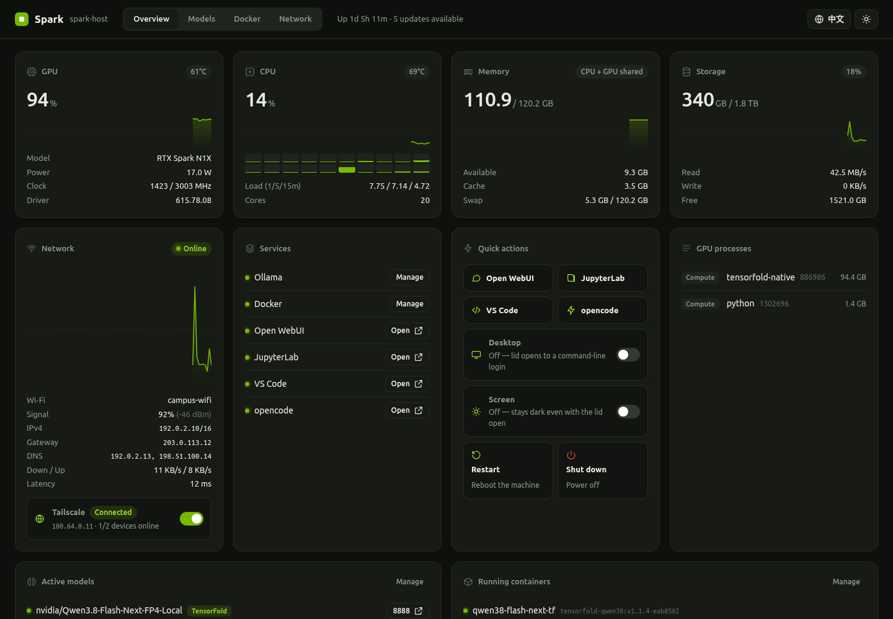
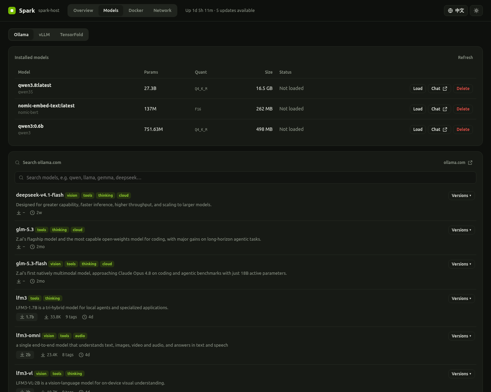
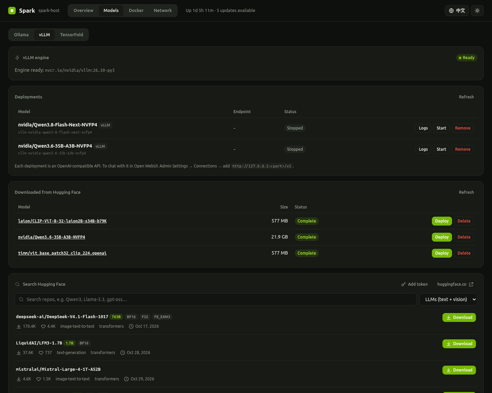
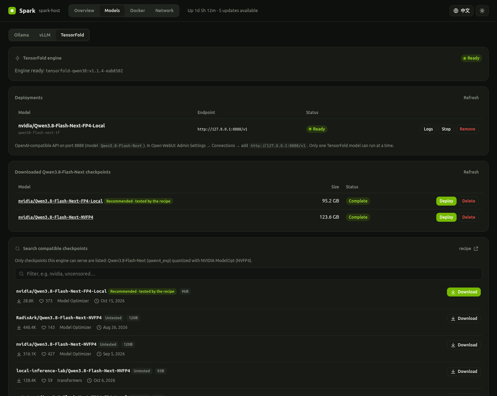
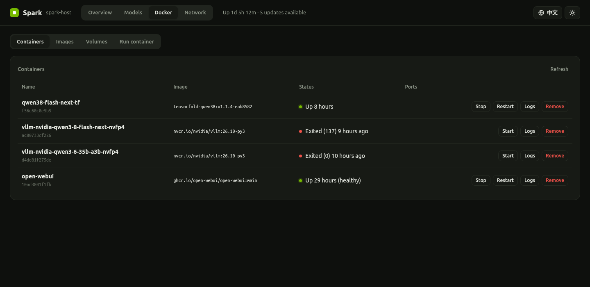
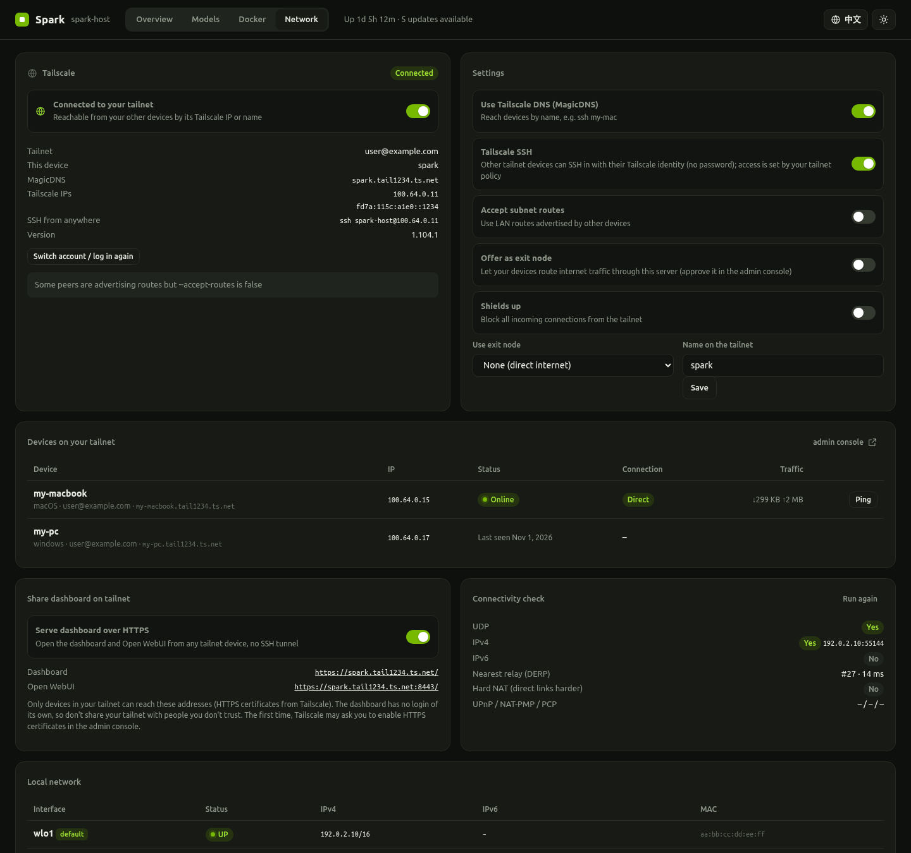
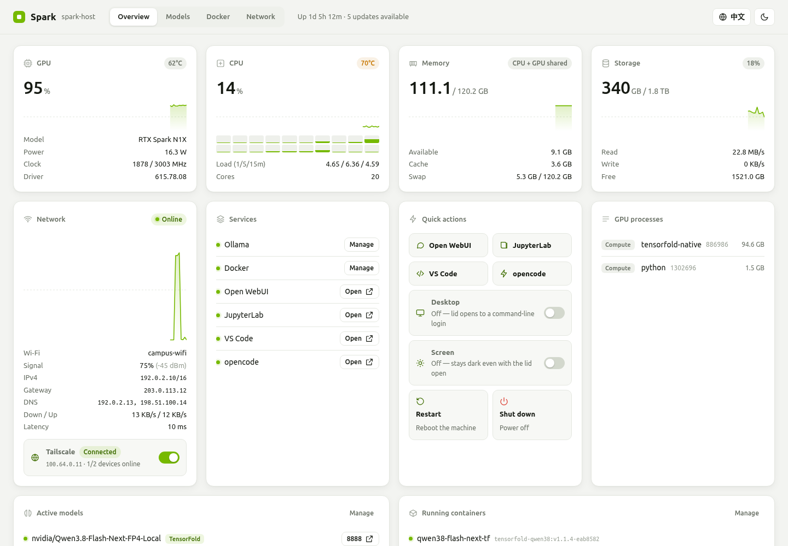

# Spark Dashboard

A self-hosted control panel that turns an **NVIDIA RTX Spark (N1X) laptop** — or any GB10-class Linux box such as a DGX Spark — into a 24/7 local-AI server. It replaces the monitoring and one-click AI tooling of NVIDIA's DGX OS, and everything sits behind **one port (11000)**, so a single SSH tunnel or a Tailscale link is all you need.



> Personal project, tested on one machine: an HP OmniBook X 14 (RTX Spark N1X, 128 GB) running Omarchy (Arch Linux, aarch64). Not affiliated with NVIDIA, HP, or any of the projects it integrates.

## Features

- **Overview** — live GPU / CPU / unified memory / storage / network charts, GPU processes, active models and containers. Quick actions: Open WebUI, JupyterLab, VS Code, opencode; desktop on/off (frees GPU memory), real screen-off for OLED panels (DPMS), restart, shut down.
- **Models**
  - **Ollama** — installed models (load / unload / delete / chat), live search of ollama.com with per-tag sizes and one-click download.
  - **vLLM** — search Hugging Face (formats vLLM can't serve are filtered out), resumable downloads, one-click deploy on NVIDIA's `nvcr.io/nvidia/vllm` container. Tool-calling and reasoning parsers are filled in automatically from the model card, so Open WebUI's tool calls work.
  - **TensorFold** — runs *Qwen3.8-Flash-Next*, which is too large for vLLM in 128 GB, with the [MiaAI-Lab single-Spark TensorFold recipe](https://github.com/MiaAI-Lab/Qwen3.8-Flash-Next-Single-DGX-Spark-TensorFold). Search lists only compatible checkpoints, and the deploy dialog checks free memory before starting.
- **Downloads that survive anything** — Hugging Face downloads use a small resumable downloader (HTTP Range, SHA-256 check, standard HF cache layout). Every download runs as its own systemd unit and resumes automatically after network drops, dashboard restarts, or reboots.
- **Docker** — containers (start / stop / logs / open published ports), images (pull with progress), volumes, and a "run container" form with a GPU switch.
- **Network** — Tailscale on/off and login, MagicDNS, Tailscale SSH, exit nodes, a device list with direct-vs-relay status and ping, a connectivity check, local interfaces, and HTTPS sharing of the dashboard on your tailnet (`tailscale serve`).
- **Developer tools** — JupyterLab with CUDA PyTorch, VS Code for the Web (the official `code serve-web`), and opencode with your running models configured as its backend automatically.
- English / 中文 UI, dark and light themes.

| | |
|---|---|
|  |  |
|  |  |
|  |  |

## How it fits together

```
browser ──► :11000  Caddy (127.0.0.1 only)
              ├─ /                    dashboard backend  :11010  (python3, stdlib only)
              ├─ /jupyter/            JupyterLab         :11001
              ├─ /code/               VS Code for the Web :11002
              ├─ webui.localhost      Open WebUI         :8080
              ├─ opencode.localhost   opencode           :4096
              └─ p<port>.localhost    any local port (e.g. a container on :8188)
```

`*.localhost` names resolve to your own machine in Chrome, Edge and Firefox, so forwarding port 11000 alone (`ssh -L 11000:localhost:11000 host`) reaches every service. Over Tailscale, the Network tab can publish the dashboard at `https://<machine>.<tailnet>.ts.net`.

## Install

Requirements: Linux with an NVIDIA GPU and driver, `python3`, `docker` with `nvidia-container-toolkit`, and `caddy`. Optional: `ollama`, `tailscale`, `opencode`.

```bash
git clone https://github.com/zyyangzy/spark-dashboard.git
cd spark-dashboard
./scripts/install.sh
```

The installer copies the dashboard to `~/.local/share/spark`, installs the systemd units (it uses sudo for the system-level ones), generates access tokens in `~/.config/spark`, and starts the entry point on `http://localhost:11000`. On a laptop it also installs the lid/screen service: closing the lid turns the screen off without suspending.

**Optional pieces**

- **JupyterLab**: `python3 -m venv ~/.local/share/spark/jupyter-venv`, then install `jupyterlab` and a CUDA build of PyTorch into it, then `systemctl --user enable --now spark-jupyter`.
- **VS Code for the Web**: place the official VS Code CLI (arm64) at `~/.local/share/spark/vscode-cli`, then `systemctl --user enable --now spark-code`.
- **opencode**: `systemctl --user enable --now spark-opencode`. Models are written to `~/.config/spark/opencode.json` and merged with your own opencode config.
- **Power menu** (desktop on/off, restart, shut down from the dashboard): `./scripts/install-power-control.sh`. It allows exactly four fixed actions through a sudoers rule.
- `extras/ubuntu-style-gnome.sh`: a GNOME desktop with Ubuntu's look, for those who prefer it over Hyprland.

## Security notes

- Every service listens on `127.0.0.1` only. Reach them through an SSH tunnel or your tailnet.
- **The dashboard has no login of its own**, and it can start containers and shut the machine down. Its POST endpoints require a custom header and only accept localhost / `*.ts.net` hosts, which blocks cross-site requests and DNS rebinding. Even so, only share it on a tailnet you fully control.
- JupyterLab, VS Code and opencode are protected by tokens or passwords stored in `~/.config/spark` (mode 600), and the dashboard passes them along when you open each service.

## Notes from the N1X laptop

- On this HP OmniBook X 14 the firmware holds the GPU to about **25 W with the lid closed** and about **50 W with it open**. Prefill is roughly 30–50 % faster with the lid open, while decode barely changes.
- Qwen3.8-Flash-Next FP4-Local on TensorFold (lid open): about 2,100–2,400 tok/s prefill and 63–70 tok/s English decode (single stream).

## Credits

- [MiaAI-Lab/Qwen3.8-Flash-Next-Single-DGX-Spark-TensorFold](https://github.com/MiaAI-Lab/Qwen3.8-Flash-Next-Single-DGX-Spark-TensorFold) (MIT) — the TensorFold image, engine settings and serve arguments used by the TensorFold tab. See [THIRD_PARTY_NOTICES.md](THIRD_PARTY_NOTICES.md).
- [TensorFold](https://github.com/ashhart/TensorFold), [vLLM](https://github.com/vllm-project/vllm) / NVIDIA NGC containers, [Ollama](https://ollama.com), [Open WebUI](https://github.com/open-webui/open-webui), [Caddy](https://caddyserver.com), [Tailscale](https://tailscale.com), [opencode](https://opencode.ai), [Omarchy](https://omarchy.org).

## License

[MIT](LICENSE)

---

## 中文简介

Spark Dashboard 是一个自托管的控制面板，把 **NVIDIA RTX Spark（N1X）笔记本**（或 DGX Spark 这类 GB10 机器）变成 7×24 小时运行的本地 AI 服务器，替代 DGX OS 的监控和一键部署功能。所有服务只走 **11000 一个端口**，一条 SSH 隧道或 Tailscale 就能访问。

- **概览**：GPU / CPU / 内存 / 存储 / 网络实时监控；快捷开关桌面、OLED 真黑屏、重启、关机。
- **模型**：Ollama（搜索 ollama.com 一键下载）、vLLM（搜索 Hugging Face，自动填写工具调用参数）、TensorFold（单机跑 Qwen3.8-Flash-Next）。下载可以断点续传，断网、重启都不怕。
- **Docker**、**网络**（Tailscale 全套管理）、JupyterLab、网页版 VS Code、opencode（自动接入当前部署的模型）。
- 中英文界面，深色 / 浅色主题。

安装方法见上方 [Install](#install)。只在作者自己的机器（HP OmniBook X 14 + Omarchy）上测试过。
